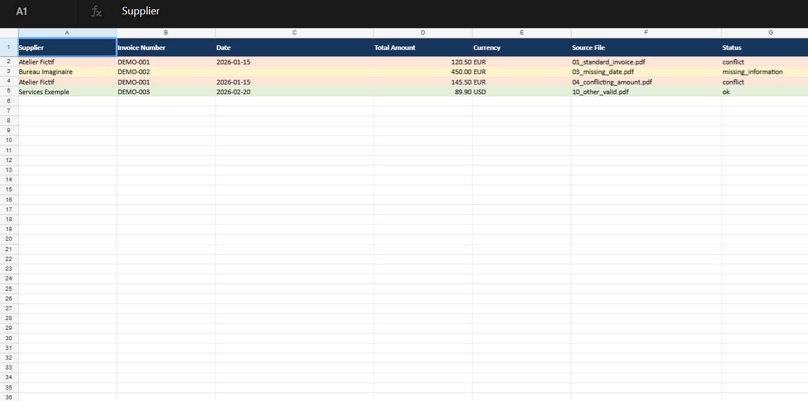
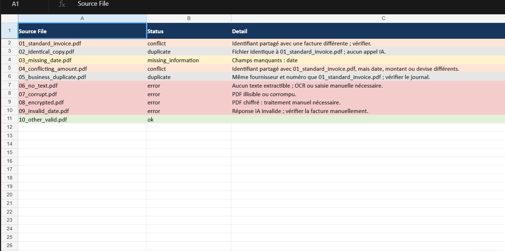

PDF Invoice Automation — Python Portfolio

### Automate invoice processing and generate structured Excel reports

A Python automation project designed to simplify invoice data extraction, reduce repetitive manual work, and help businesses organize financial documents efficiently.

This project demonstrates a workflow that processes PDF invoices, extracts relevant information, identifies potential issues, and generates an Excel report.

## Key Features

- **PDF Data Extraction:** Extract supplier names, invoice numbers, dates, amounts, and currencies.
- **Automated Excel Reports:** Organize extracted information into structured Excel spreadsheets.
- **Duplicate Detection:** Identify duplicate invoices and repeated documents.
- **Data Validation:** Detect missing information, invalid dates, and conflicting invoice details.
- **Error Handling:** Identify unreadable, encrypted, or corrupted PDF documents.
- **Processing Logs:** Generate detailed reports showing successful operations and documents requiring manual review.
- **AI Integration:** Supports structured invoice analysis using the OpenAI API in its full processing mode.

## How It Works

1. The user provides a folder containing PDF invoices.
2. The program examines each document and extracts available text.
3. Invoice information is analyzed and validated.
4. Duplicate records and inconsistencies are detected.
5. An Excel report is generated.
6. Documents requiring manual verification are identified.

## Demonstration Results

The project was tested locally on Windows using fictional invoice documents.

| Test Metric | Result |
|---|---|
| Automated tests | 42 passed, 1 skipped |
| Demonstration PDF documents | 10 |
| Invoice records exported | 4 |
| Duplicate detection | Verified in local tests |
| Missing information detection | Verified |
| Conflict detection | Verified |
| Excel report generation | Verified |

The demonstration uses simulated AI responses and does not require paid API calls.

## Demo Screenshots

### Extracted Invoice Data

### Processing Log and Error Detection

## Excel Report Structure

The generated Excel workbook contains two worksheets:

**Invoices:** Extracted invoice information, including supplier, invoice number, date, amount, currency, source file, and processing status.

**Processing Log:** A detailed record of processed documents, errors, duplicates, and potential inconsistencies.

## Technologies

- Python
- OpenPyXL
- pypdf
- OpenAI API (optional live processing)
- JSON
- Automated testing with unittest

## Current Limitations

- Real OpenAI API integration has not yet been independently verified.
- Scanned PDF documents without extractable text require OCR or manual processing.
- Some inconsistent invoice information requires human review.
- Live business deployment has not yet been validated.

## Source Code and Availability

This repository is a **public portfolio showcase**.

The complete application source code is maintained in a separate private repository.

The purpose of this page is to demonstrate the project's functionality, technical approach, and tested results without distributing the full implementation.

## Freelance Services

Interested in automating repetitive document-processing tasks?

Potential services include:

- PDF invoice processing automation
- PDF-to-Excel data extraction workflows
- Excel report generation
- Data validation and duplicate detection
- Custom Python automation for administrative workflows

Solutions can be adapted to specific business requirements, subject to testing and validation.

**Contact:** Visit my GitHub profile to discuss a potential automation project.

---

*Developed as part of my Python automation portfolio.*
